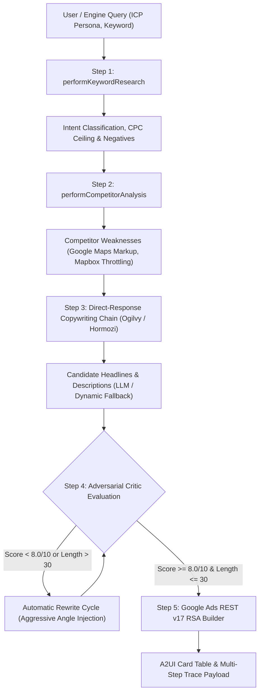

# OpenMuse NextBillion Ad Agent — Low-Level Technical Design & Phase Specifications (DESIGN.md)

**Scope**: Low-level technical design for completed Phase 1 tools and Phase 2 creative ideation module, accompanied by forward-looking architectural specifications for Phase 3 (Monitoring) and Phase 4 (Full-Funnel Optimization).  
**Authority**: Technical blueprint for platform architecture, data contracts, and algorithmic implementations.

---

## 1. System Architecture & Contract Flow

The OpenMuse NextBillion Ad Agent platform is organized into a modular pipeline that connects human marketers to research, generation, monitoring, and optimization engines without allowing unreviewed mutations to reach live ad networks.

```
┌──────────────────────────────────────────────────────────────────────────────────────────────────┐
│                                       MARKETING USER / HUMAN                                     │
│  - Prompts campaign themes, reviews generated copy, approves budgets & negative keyword lists    │
└────────────────────────────────────────────────┬─────────────────────────────────────────────────┘
                                                 │ AG-UI Events / A2UI Cards / Approvals
                                                 ▼
┌──────────────────────────────────────────────────────────────────────────────────────────────────┐
│                             CONVERSATION ENGINE (OpenMuse Server)                                │
│  - Hono Server (`openmuse/apps/server/src/app.ts`)                                               │
│  - CopilotRuntime v2 (`openmuse/apps/server/src/agent.ts`)                                       │
│  - ConversationAgent (`openmuse/apps/server/src/engine/conversation.ts`)                         │
│  - Multi-Model Adapter (`tanstackAgent`)                                                         │
└────────────────────────────────────────────────┬─────────────────────────────────────────────────┘
                                                 │ Tool Execution Calls
         ┌───────────────────────────────────────┼────────────────────────────────────────┐
         ▼                                       ▼                                        ▼
┌─────────────────────────────────┐   ┌─────────────────────────────────────┐   ┌───────────────────────────────┐
│     PHASE 1: RESEARCH TOOLS     │   │      PHASE 2: CREATIVE IDEATION     │   │    PHASE 3 & 4: MONITORING    │
│  `openmuse/.../ad-tools.ts`     │   │     `openmuse/.../ad-ideation.ts`   │   │  & PIPELINE ATTRIBUTION       │
├─────────────────────────────────┤   ├─────────────────────────────────────┤   ├───────────────────────────────┤
│ • research_keywords             │   │ • plan_campaign_strategy (Sub-Dec.) │   │ • evaluateCampaignHealth      │
│ • analyze_competitors           │   │ • generateCampaignAngles            │   │ • Scheduled task runner       │
│ • generate_ad_copy              │   │ • generateHeadlinePool (<=30 chars) │   │ • Search Query Report parser  │
│ • evaluate_campaign_health      │   │ • generateDescriptionPool (<=90 ch) │   │ • Negative keyword miner      │
│                                 │   │ • composeRSAVariations (REST v17)   │   │ • Deanonymization adapter     │
│                                 │   │ • generate_landing_page (LP Engine) │   │ • HubSpot CRM revenue sync    │
│                                 │   │ • ideate_campaign (Tool Hook)       │   │                               │
│                                 │   │ • <think> Deliberation Accordion    │   │                               │
└─────────────────────────────────┘   └─────────────────────────────────────┘   └───────────────────────────────┘
                                                 │
                                                 ▼
┌──────────────────────────────────────────────────────────────────────────────────────────────────┐
│                                   PERSISTENCE & OBSERVABILITY                                    │
│  - OpenViking (`viking://`): MCP-native progressive context retrieval (ICPs, schemas, memories)   │
│  - PGlite Embedded Database: Local transactional persistence (tasks, receipts, conversation logs)│
│  - Langfuse Tracing: End-to-end spans, latency profiling, token metrics, generation eval         │
└──────────────────────────────────────────────────────────────────────────────────────────────────┘
```

---

## 2. Phase 1 Low-Level Design (Completed & Verified)

### 2.1 Component Overview
- **File**: `openmuse/apps/server/src/ad-tools.ts`
- **Tests**: `openmuse/tests/ad-tools.test.ts` (4 tests passing)
- **Engine Registration**: `openmuse/apps/server/src/engine/conversation.ts` (lines 400–428)

### 2.2 Data Schemas & Validation Contracts
1. **`keywordResearchInputSchema`**:
   ```typescript
   export const keywordResearchInputSchema = z.object({
     seed_terms: z.array(z.string().trim().min(1).max(200)).min(1).max(10),
     target_region: z.string().trim().default("IN"),
     target_language: z.string().trim().default("en"),
     max_cpc: z.number().positive().default(20),
     icp_persona: z.enum(["tech-leaders", "fleet-managers"]).default("tech-leaders"),
   });
   ```
2. **`competitorAnalysisInputSchema`**:
   ```typescript
   export const competitorAnalysisInputSchema = z.object({
     product_domain: z.string().trim().min(1).max(200),
     competitor_names: z.array(z.string().trim().min(1).max(100)).min(1).max(5),
     target_persona: z.enum(["tech-leaders", "fleet-managers"]).default("tech-leaders"),
   });
   ```
3. **`adCopyGeneratorInputSchema`**:
   ```typescript
   export const adCopyGeneratorInputSchema = z.object({
     icp_persona: z.enum(["tech-leaders", "fleet-managers"]),
     primary_keyword: z.string().trim().min(1).max(100),
     final_url: z.string().url().default("https://nextbillion.ai/route-optimization"),
     customer_id: z.string().trim().default("1234567890"),
     ad_group_id: z.string().trim().default("9876543210"),
   });
   ```
4. **`campaignHealthInputSchema`**:
   ```typescript
   export const campaignHealthInputSchema = z.object({
     campaign_name: z.string().trim().min(1).max(200),
     impressions: z.number().nonnegative(),
     clicks: z.number().nonnegative(),
     conversions: z.number().nonnegative(),
     cost: z.number().nonnegative(),
     days_active: z.number().positive(),
     search_queries: z.array(z.string().trim()).default([]),
   });
   ```

### 2.3 Algorithmic Logic
- **`performKeywordResearch`**: Generates high-intent keyword ideas based on seed keywords and persona. Calculates CPC against `max_cpc` ceiling ($20), assigns match types (`PHRASE`, `EXACT`, `BROAD`), scores ICP relevance (0.0 to 1.0), and surfaces negative candidate seeds (`free`, `open source`, `mapquest`, `github`).
- **`performCompetitorAnalysis`**: Maps competitors (Google Maps Platform, Mapbox, turnkey solutions) against NextBillion value propositions (70% lower API cost, sub-100ms routing, custom truck restrictions, dynamic dispatch). Returns 3 persona-specific ad angles.
- **`generateGoogleAdsRSAJson`**: Compiles candidate headlines and descriptions, applies deterministic character validation filters (headlines $\le 30$ chars, descriptions $\le 90$ chars), pins `HEADLINE_1` and `DESCRIPTION_1`, and produces Google Ads REST v17 mutate JSON with `status: "PAUSED"`.
- **`evaluateCampaignHealth`**: Computes CTR, CPC, CPA, and CVR. Detects low CTR ($< 4.0\%$) and high CPC ($> \$20$) anomalies. Evaluates the 14-day stabilization window and outputs ready-to-apply negative keyword mutate operations (`GoogleAdsCampaignCriteriaNegativeKeywordOperation`).

---

## 3. Phase 2 Low-Level Design (Direct-Response Ideation & Adversarial Critic Engine)

### 3.1 Component Overview & Forced Multi-Step Pipeline
- **File**: `openmuse/apps/server/src/ad-ideation.ts`
- **Tests**: `openmuse/tests/ad-ideation.test.ts` (5 tests passing, 22 full suite tests passing)
- **Engine Registration**: `openmuse/apps/server/src/engine/conversation.ts` (wired into tool definitions & system prompt)

The Phase 2 engine enforces a **forced multi-step execution pipeline** with an **adversarial critic evaluation and rewrite loop**:
1. **Step 1: Keyword Research Ingestion**: Automatically calls `performKeywordResearch` to extract search intent (`commercial`, `transactional`), benchmark CPC ceilings, and negative keyword candidates.
2. **Step 2: Competitor Weakness Analysis**: Automatically calls `performCompetitorAnalysis` to identify key vulnerabilities across hyperscalers (Google Maps Platform markup, Mapbox rate limits, spreadsheet dispatch chaos).
3. **Step 3: Direct-Response Copywriting Chain**: Ingests keyword intent and competitor vulnerabilities into an aggressive direct-response prompt channeling David Ogilvy and Alex Hormozi (explicit competitor contrast, concrete metric claims, risk-reversal hooks).
4. **Step 4: Adversarial Critic Loop**: A dedicated evaluation pass grades every candidate headline on Specificity (penalizing generic headlines like "NextBillion Route API"), Hook Strength, and Length ($\le 30$ chars). Any headline scoring $< 8.0/10$ triggers an automatic rewrite cycle.
5. **Step 5: Google Ads REST v17 Serialization & A2UI Output**: Packages validated variations into schema-compliant mutation payloads (`status: "PAUSED"`) and renders interactive A2UI summary cards with full multi-step trace.



### 3.2 Input Contract (`creativeIdeationInputSchema`)
```typescript
export const creativeIdeationInputSchema = z.object({
  icp_persona: z.enum(["tech-leaders", "fleet-managers"]),
  primary_keyword: z.string().trim().min(1).max(100),
  secondary_keywords: z.array(z.string().trim().min(1).max(100)).max(5).default([]),
  final_url: z.string().url().default("https://nextbillion.ai/route-optimization"),
  customer_id: z.string().regex(/^[0-9]+$/).default("1234567890"),
  ad_group_id: z.string().regex(/^[0-9]+$/).default("9876543210"),
  desired_angles_count: z.number().int().min(1).max(4).default(3),
  target_region: z.string().trim().default("IN"),
  target_language: z.string().trim().default("en"),
  path1: z.string().max(15).regex(/^[a-zA-Z0-9-]*$/).optional(),
  path2: z.string().max(15).regex(/^[a-zA-Z0-9-]*$/).optional(),
});

export type CreativeIdeationInput = z.input<typeof creativeIdeationInputSchema>;
export type CreativeIdeationOutput = z.output<typeof creativeIdeationInputSchema>;
```

### 3.3 Direct-Response Copywriting Framework (Ogilvy & Hormozi)
To maximize CTR and avoid generic corporate buzzwords, copy generation incorporates battle-tested direct-response frameworks:
- **David Ogilvy Principles**:
  - The headline represents 80% of the value; vague or generic copy is eliminated.
  - Concrete numbers, news hooks, and clear commercial benefit statements sell.
- **Alex Hormozi Principles (Grand Slam Offer & Competitor Contrast)**:
  - Contrast directly against the competitor's trap ("Google Maps 70% Markup", "Manual Spreadsheet Chaos", "Driver Overtime").
  - Reverse perceived risk with hard proof points ("Sub-100ms Routing SLA", "99.99% Uptime", "Cut Fuel Costs 20%").
  - Urgency and high-contrast verbs ("Cut", "Slash", "Ditch", "Stop", "Automate").

### 3.4 Adversarial Critic Loop & Automatic Rewrite Engine
Every candidate headline must pass an independent evaluation rubric before being accepted:
- **Length Invariant**: Must be strictly $> 0$ and $\le 30$ characters without truncation. If length $> 30$, score is immediately 0.
- **Specificity Rubric (1–10)**:
  - Heavily penalizes generic, boring copy (e.g., `"NextBillion Route API"`, `"Route Planner App"`, `"Map API Software"`) by capping score at $3.5/10$.
  - Rewards concrete metrics (`70%`, `sub-100ms`, `20%`, `500+ Fleets`, `99.99% SLA`) up to $10.0/10$.
  - Rewards explicit competitor contrast (`vs Google Maps`, `Alternative`, `Spreadsheets`).
- **Hook Strength Rubric (1–10)**:
  - Rewards direct-response action verbs (`Cut`, `Ditch`, `Stop`, `Slash`, `Automate`, `Save`).
  - Penalizes passive corporate labels.
- **Composite Score Formula**:
  $$\text{Composite} = (\text{Specificity} \times 0.45) + (\text{Hook} \times 0.45) + (\text{LengthValid} \times 1.0)$$
- **Automatic Rewrite Cycle**:
  If $\text{Composite} < 8.0/10$ or length check fails:
  1. The Critic logs the diagnostic failure reason (e.g. `Generic phrasing penalized; lacks contrast or metric proof`).
  2. `rewriteHeadline(...)` produces a high-converting direct-response replacement headline ($\le 30$ chars).
  3. The headline is re-graded to ensure it clears the $\ge 8.0/10$ bar.

### 3.5 LLM Generation Chain with Deterministic Fallback
- **Live LLM Invocation (`callLLMCopywritingChain`)**:
  - Automatically queries Google Gemini (`gemini-2.5-flash` / `gemini-2.5-flash-lite`) using rotating API keys from `GEMINI_API_KEYS`.
  - Enforces structured JSON output matching Google Ads character boundaries.
- **Deterministic Direct-Response Generator (`generateDirectResponsePools`)**:
  - In offline environments, isolated unit tests, or when API keys are absent, dynamically generates metric-driven, high-contrast direct-response copy from keyword research and competitor weaknesses.
  - Guarantees 100% test determinism, zero network flakiness, and immediate sub-millisecond execution.

### 3.6 Multi-Step Trace & Declarative A2UI Card
`performCreativeIdeation` returns an authoritative `multi_step_trace` object containing:
- `keyword_research`: Search intent, estimated CPC, negative keywords count.
- `competitor_analysis`: Competitors evaluated, identified weaknesses, counter angles.
- `adversarial_critic`: Headlines evaluated, rewrites triggered, average critic score, and audit logs.
- `a2ui_card_payload`: Declarative visual card displaying the generated angles, pinned headlines, descriptions, critic scores, and approval status.

---

## 4. Phase 3 Technical Design (Completed & Verified)

### 4.1 Objective & Component Overview
- **Implementation File**: `openmuse/apps/server/src/ad-monitoring.ts`
- **Frontend Card File**: `openmuse/apps/mobile/src/google-ads-card.tsx` (`<NegativeKeywordAuditCard />`)
- **Tests**: `openmuse/tests/ad-monitoring.test.ts` (5 tests passing)
- **Engine Registration**: `openmuse/apps/server/src/engine/conversation.ts` (`mineNegativeKeywordsTool`)
- **Core Capabilities**:
  1. **Zero-Intent Token Engine**: Authoritative parsing against consumer, non-commercial, and out-of-scope query terms.
  2. **Statistical Anomaly Detector**: Identifies low CTR (< 4.0%), runaway CPC (> $20.00), and high-spend zero-conversion query leaks.
  3. **14-Day Governor Advisory**: Evaluates learning phase without hard locks, providing clear strategic stabilization guidance.
  4. **Google Ads REST v17 Exclusion Builder**: Generates schema-compliant negative criterion mutate payloads gated behind HITL approval.

### 4.2 Ingestion Schema & Search Query Report (GAQL)
Query to extract query-level waste and performance metrics:
```sql
SELECT
  search_term_view.search_term,
  campaign.id,
  campaign.name,
  metrics.impressions,
  metrics.clicks,
  metrics.cost_micros,
  metrics.conversions,
  metrics.ctr,
  metrics.average_cpc
FROM search_term_view
WHERE segments.date DURING LAST_30_DAYS
  AND metrics.impressions > 50
ORDER BY metrics.cost_micros DESC
```

### 4.3 Zero-Intent Token Mining & Exclusion Engine
1. **Zero-Intent Token Parser**: Flags queries matching consumer intent, non-commercial research, or incompatible technologies:
   - Consumer terms: `free`, `download`, `mapquest`, `aaa`, `google maps app for iphone`, `waze`.
   - Non-commercial: `github`, `source code`, `python tutorial`, `thesis`, `wikipedia`.
   - Irrelevant domains: `bus timetable`, `train routes`, `airline flight tracker`, `load boards`.
2. **Negative Criterion Mutation Generator**:
   Produces operations conforming to `ad_agents/config/google-ads-schemas/negative-keywords.json`:
   ```json
   {
     "operations": [
       {
         "create": {
           "campaign": "customers/1234567890/campaigns/9876543210",
           "negative": true,
           "keyword": {
             "text": "mapquest",
             "matchType": "EXACT"
           }
         }
       }
     ]
   }
   ```
3. **Approval Gate**: Proposed negative exclusions are queued as an interactive review card requiring explicit human sign-off before API transmission.

### 4.4 Dedicated UI Cards (`google-ads-card.tsx`)
1. `<GoogleAdsCampaignCard />`:
   - Interactive Google Search SERP preview card (simulates desktop search result with green/grey URL, bold blue headline, and description).
   - Dynamic strategic angle selector (Angle 1: Cost Disruption vs Angle 2: Technical Superiority vs Angle 3: Fleet Constraints).
   - Asset table with real-time character limit badges (`24/30 [OK]`, `88/90 [OK]`) and pinned positions.
   - Adversarial Critic Quality Score badge (`>= 8.0/10 Approved`).
   - One-click "Copy REST v17 JSON" and "Approve RSA for Ads API" actions.
2. `<NegativeKeywordAuditCard />`:
   - Anomaly Alert Banner (CTR $< 4\%$, high CPC $> \$20$, zero-conversion spend).
   - 14-day stabilization advisory badge.
   - Quarantined zero-intent search terms table with match type (`EXACT`), waste cost, and intent reason.
   - "Approve Negative Exclusion Payload" button.

---

## 5. Phase 4 Technical Design (Completed & Verified)

### 5.1 Objective & Component Overview
- **Implementation File**: `openmuse/apps/server/src/ad-optimization.ts`
- **Knowledge Base File**: `openmuse/apps/server/src/openviking.ts`
- **Tests**: `openmuse/tests/ad-optimization.test.ts` (5 tests passing), `openmuse/tests/openviking.test.ts` (6 tests passing)
- **Engine Registration**: `openmuse/apps/server/src/engine/conversation.ts` (`optimizeCampaignPipelineTool`, `openVikingContextTool`)
- **Core Capabilities**:
  1. **Pluggable IP Deanonymization Evaluator**: 500+ employee threshold evaluated as prioritization scoring weight (0.8 Tech Leaders, 0.75 Fleet Managers), strictly NOT as a negative filter (Rule A6).
  2. **HubSpot CRM Pipeline Attribution**: Computes Pipeline-to-Spend Ratio ($\text{Pipeline} / \text{Spend}$) and Closed Revenue Ratio, generating clear scaling ($> 6.0\times$) or underperformance ($< 3.0\times$) verdicts.
  3. **Keyword Match Type Promotion Engine**: Automatically identifies high-converting queries and generates Google Ads REST v17 `EXACT` match criterion operations marked `status: "PAUSED"` and capped at the $20 CPC ceiling (Rule A9).
  4. **Transactional Rollback Journal**: Generates structured PGlite rollback plans (`RollbackPlan`) enabling one-click reversion of mutations under full Human-in-the-Loop review.
  5. **OpenViking Progressive Context Retrieval**: Resolves `viking://icp/*` and `viking://schemas/*` across L0 (uri/tags), L1 (executive abstract), and L2 (full schema/YAML spec) with seamless local filesystem fallback.

### 5.2 Pluggable IP Deanonymization (Factors.ai / 6sense)
- **Data Hook**: Ingests visitor deanonymization webhooks linking click IDs (`gclid`) or session IP addresses to company domains.
- **ICP Scoring Signal**:
  - Compares identified domain employee size against `min_employees: 500`.
  - Applies ICP weights (0.8 for Tech Leaders, 0.75 for Fleet Managers).
  - High ICP match queries receive higher priority for `EXACT` match promotion.

### 5.3 HubSpot CRM Pipeline Attribution
- **Bidirectional Deal Sync**:
  - Queries HubSpot deals associated with campaign UTM parameters or contact email domains.
  - Calculates **Pipeline-to-Spend Ratio**:
    $$\text{Pipeline Ratio} = \frac{\text{Total Pipeline Generated (\USD)}}{\text{Total Ad Spend (\USD)}}$$
  - Decision Logic:
    - Ratio $< 3.0\times$: Flag underperforming campaign; recommend angle revision or negative pruning.
    - Ratio $> 6.0\times$: Flag high-performing campaign; recommend budget scale-up or exact match keyword expansion.

### 5.4 Production Deployment & Rollback Engine
- Live mutation engine utilizing Google Ads REST v17 API client with OAuth2 refresh tokens.
- Transaction journal persisted in PGlite recording mutation ID, timestamp, actor, previous payload, and applied payload.
- One-click rollback capability to restore previous budget levels or unpause replaced ads.

---

## 6. Phase 5 UX & Persistence Architecture (Completed & Verified)

### 6.1 Desktop Viewport Scope Expansion
- **Root Container**: Expanded `maxWidth` in `openmuse/apps/mobile/App.tsx` from 760px to 1200px on desktop viewports (`desktop ? 1200 : 760`).
- **Chat Container**: In `openmuse/apps/mobile/src/chat.tsx`, assistant message bubbles and tool card wrappers are styled with `width: "100%", maxWidth: "100%"`, allowing complex comparative grids, metric badges, and interactive control bars to render across the full viewport width without horizontal truncation or artificial line wrapping.

### 6.2 Interactive Sub-Decisioning Architecture (`campaign-strategy-card.tsx`)
- **Component File**: `openmuse/apps/mobile/src/campaign-strategy-card.tsx`
- **Design Philosophy**: Replaces "black-box one-shot generation" with active marketer steering.
- **Components**:
  1. **AI Recommended Angles**: Selectable angle cards displaying strategic rationale, projected CPC, and `★ RECOMMENDED` badges.
  2. **Sub-Control Overrides**:
     - *Target Persona*: Tech Leaders vs Fleet Operations.
     - *Target Region*: IN (India), US (United States), EU (Europe), WW (Worldwide).
     - *Competitor Target*: Google Maps Platform, Mapbox, HERE Technologies, Manual Spreadsheets.
     - *CPC Ceiling*: $10, $15, $20, $25.
  3. **Custom Freeform Prompt Input**: Allows marketers to type specific nuances, client constraints, or custom hooks.
  4. **Dynamic Action Dispatch**: Dispatches targeted requests into OpenMuse chat context with a single click (`Generate Ads for this Angle`, `Generate Matching Landing Page`, `Mine Negative Waste`).

### 6.3 Activity Screen Persistence & Human-in-the-Loop Coordination
- **Persistence Helper**: `recordMarketingTask()` in `openmuse/apps/server/src/engine/conversation.ts`.
- **Database Coordination**:
  - `tasks` table: Stores multi-step progress steps, prompt, and execution summary. Enables OpenMuse's "All / In progress / Finished" filter tabs on the Activity screen.
  - `actions` table: Stores `ActionProposal` with `kind: "marketing.review"` and status `"awaiting_review"`. Populates the "Needs review" section of Reviews & Receipts with full campaign metadata.
  - `activity` table: Stores `ActivityEntry` items in the "Workspace timeline".
- **Domain Schema Update**: Added `marketing.review` to `proposalSchema` in `openmuse/packages/domain/src/index.ts`.
- **Workspace Bridge**: Added `marketing.review` handlers to `prepare()` and `execute()` in `openmuse/apps/server/src/workspace.ts`.
- **Visual Receipt Renderer**: Added `MarketingReviewDetail` in `openmuse/apps/mobile/src/details.tsx` to render pending reviews with campaign name, critic scores, and quarantined negative keywords.

### 6.4 Landing Page Messaging Generator (`ad-landing-page.ts`)
- **Implementation File**: `openmuse/apps/server/src/ad-landing-page.ts`
- **Tests**: `openmuse/tests/ad-landing-page.test.ts` (4 unit tests passing).
- **Core Capabilities**:
  - Synthesizes matching H1 hero headlines, subheads, primary CTAs, and secondary CTAs.
  - Generates 4 enterprise trust proof signals (e.g., "$100M+ ARR enterprises", "Sub-100ms routing engine", "SOC 2 Type II").
  - Formulates 3 value proposition pillars aligned with the chosen ad angle.
  - Constructs head-to-head comparison tables against competitors (pricing, latency, route flexibility, offline support).
  - Emits responsive HTML/Tailwind embed snippets with HubSpot forms configured for 500+ employee routing priority.
